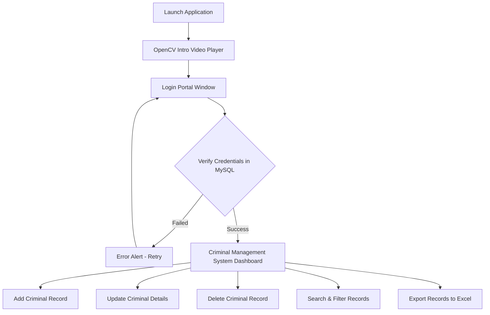

# Criminal Management System Software

[](https://www.python.org/)
[](https://docs.python.org/3/library/tkinter.html)
[](https://www.mysql.com/)
[](https://opencv.org/)
[](https://pandas.pydata.org/)
[](https://opensource.org/licenses/MIT)

A desktop-based **Criminal Record Management System** developed as a Class 12 Computer Science Project. This software provides law enforcement agencies and administrative personnel with an intuitive interface to catalog, update, search, and export criminal case files and suspect profiles, backed by a relational MySQL database.

---

## 📌 Table of Contents

- [Features](#-features)
- [System Architecture & Flow](#-system-architecture--flow)
- [Tech Stack](#-tech-stack)
- [Database Schema](#-database-schema)
- [Project Structure](#-project-structure)
- [Prerequisites](#-prerequisites)
- [Installation & Setup](#-installation--setup)
  - [1. Clone Repository](#1-clone-the-repository)
  - [2. Set Up Virtual Environment](#2-set-up-virtual-environment)
  - [3. Install Dependencies](#3-install-dependencies)
  - [4. Database Configuration](#4-database-configuration)
  - [5. Run the Application](#5-run-the-application)
- [User Credentials](#-user-credentials)
- [License & Acknowledgments](#-license--acknowledgments)

---

## ✨ Features

- **🎬 Video Splash Screen**: Embedded intro animation rendered via OpenCV (`cv2.VideoCapture`) before launching the primary authentication portal.
- **🔐 Secure Authentication**: Integrated login system validating credentials against MySQL user tables.
- **📋 Criminal Profile Management**:
  - Full CRUD operations (Create, Read, Update, Delete) on case dossiers.
  - Detailed fields including Case ID, Criminal Number, Name, Alias/Nickname, Arrest Date, Date of Crime, Address, Age, Occupation, Identification/Birthmarks, Crime Type, Father's Name, Gender, and Wanted Status.
- **🔍 Dynamic Search & Filtering**: Query and filter records by selected attributes using SQL pattern matching (`LIKE %term%`).
- **📊 Real-time Table View**: Interactive `ttk.Treeview` with auto-selection; selecting a table row automatically populates editing inputs.
- **📁 Excel Export**: One-click export of filtered or visible records to `.xlsx` spreadsheets via `pandas` and `openpyxl`.
- **🎨 Custom Themed Interface**: Police & National Crime Records theme with graphical headers, badges, and logos.

---

## 🏗 System Architecture & Flow



---

## 🛠 Tech Stack

| Component | Technology | Description |
| :--- | :--- | :--- |
| **Language** | Python 3.8+ | Core application logic |
| **GUI Framework** | Tkinter & `ttk` | Graphical interface and widgets |
| **Database** | MySQL | Relational data persistence |
| **DB Driver** | `mysql-connector-python` | Connector interfacing Python and MySQL |
| **Computer Vision** | OpenCV (`cv2`) | Video playback and frame scaling |
| **Image Processing**| Pillow (`PIL`) | Handling high-resolution PNG assets and icons |
| **Data Export** | Pandas & OpenPyXL | Spreadsheet formatting and file output |

---

## 🗄 Database Schema

The system uses a MySQL database named **`management`** containing two primary tables:

### 1. `login` Table
| Column | Type | Constraints | Description |
| :--- | :--- | :--- | :--- |
| `userid` | VARCHAR(50) | PRIMARY KEY | Username for authentication |
| `password` | VARCHAR(50) | NOT NULL | User account password |

### 2. `criminal` Table
| Column | Type | Constraints | Description |
| :--- | :--- | :--- | :--- |
| `Case_id` | VARCHAR(50) | PRIMARY KEY | Unique identifier for the criminal case |
| `Criminal_no` | VARCHAR(50) | NOT NULL | Official registered criminal number |
| `Criminal_name` | VARCHAR(100) | NOT NULL | Full legal name |
| `Nick_name` | VARCHAR(50) | - | Aliases or street names |
| `arrest_date` | VARCHAR(50) | - | Date of arrest |
| `dateOfcrime` | VARCHAR(50) | - | Date on which the offense occurred |
| `address` | VARCHAR(255) | - | Residential or last known address |
| `age` | VARCHAR(10) | - | Age of the individual |
| `occupation` | VARCHAR(100) | - | Occupation / Background |
| `BirthMark` | VARCHAR(100) | - | Distinctive scars or identifying marks |
| `crimeType` | VARCHAR(100) | - | Classification of crime (e.g. Theft, Fraud) |
| `fatherName` | VARCHAR(100) | - | Father's name |
| `gender` | VARCHAR(20) | - | Gender |
| `wanted` | VARCHAR(20) | - | Most Wanted status (Yes / No) |

---

## 📂 Project Structure

```plaintext
12-th-project/
├── Total code.py          # Main application executable script
├── schema.sql             # SQL schema setup script for MySQL
├── requirements.txt       # Python package dependencies
├── .gitignore             # Git ignore patterns for Python projects
├── README.md              # Project documentation
├── 12th CS Project.docx   # Project documentation report
├── 123.mp4                # Intro splash video
├── 1.png                  # Background asset for login window
├── 2.png, 3.png, 4.png    # Dashboard header image assets
├── 5.png                  # Main dashboard hero banner
├── ncr_logo.png           # Crime records department logo
├── Criminals .xlsx        # Sample exported records
└── criminal912539.xlsx    # Sample generated report
```

---

## ⚙ Prerequisites

- **Python 3.8 or later** installed on your system.
- **MySQL Server** (MySQL 8.0, MariaDB, or XAMPP / WampServer).

---

## 🚀 Installation & Setup

### 1. Clone the Repository
```bash
git clone https://github.com/abhisheikraja2007-droid/12-th-project.git
cd 12-th-project
```

### 2. Set Up Virtual Environment

**Windows (PowerShell / Command Prompt):**
```powershell
python -m venv venv
.\venv\Scripts\activate
```

**macOS / Linux:**
```bash
python3 -m venv venv
source venv/bin/activate
```

### 3. Install Dependencies
```bash
pip install -r requirements.txt
```

### 4. Database Configuration

1. Launch your MySQL command-line client or MySQL Workbench.
2. Run the provided [`schema.sql`](schema.sql) file to create the database and required tables:
   ```bash
   mysql -u root -p < schema.sql
   ```
   *Or paste the contents of `schema.sql` directly into MySQL Workbench.*
3. Verify connection settings in `Total code.py`:
   ```python
   # Default settings in code:
   conn = mysql.connector.connect(
       host='localhost',
       username='root',
       password='123',       # Update this with your local MySQL password
       database='management'
   )
   ```

### 5. Run the Application

```bash
python "Total code.py"
```

---

## 🔑 User Credentials

Default credentials seeded via `schema.sql`:

| Role | Username | Password |
| :--- | :--- | :--- |
| **Administrator** | `admin` | `admin` |
| **Officer** | `user` | `123` |

---

## 📝 License & Acknowledgments

- Developed by **Abhisheik Raja ST** as a Class 12 Computer Science Project.
- Released under the [MIT License](LICENSE).
